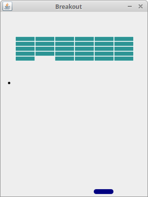

# Java Breakout Game - Refactored
Java Breakout game source code

http://zetcode.com/javagames/breakout/

This is an academic project aimed at refactoring the classic Breakout game by applying **Software Design Patterns** without adding new gameplay features.

## Design Patterns Implemented
### Stage 1: Creational Patterns
- **Singleton Pattern:** Refactored `Commons.java` into `GameConfig.java` to manage application settings with a single instance.
- **Factory Method Pattern:** Added `GameObjectFactory.java` so `Board` creates the ball, paddle and bricks through a factory instead of using `new` directly.

### Stage 2: Structural Patterns
- **Flyweight Pattern:** Added `ImageFactory.java`, which loads each image once and shares it. All 30 bricks now use one shared `brick.png` image instead of loading 30 copies.
- **Facade Pattern:** Added `GameControllerFacade.java`, which groups object movement, collision checks and win/lose logic behind two simple methods (`updateMotion()` and `checkCollisions()`). `Board` now only draws the game and handles keyboard input.

## Credits & Acknowledgments
- **Original Source Code:** ZetCode Java Breakout Game Tutorial.
- **Refactoring & Design Patterns:** Academic assignment for Software Design Patterns course.

